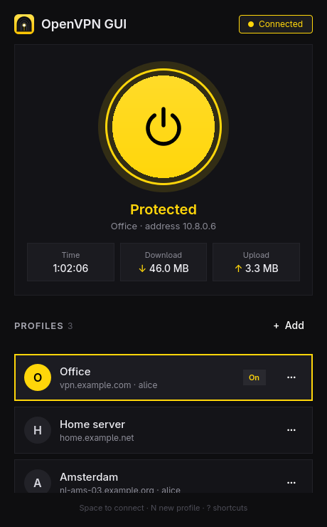

<div align="center">


# OpenVPN GUI

Saved OpenVPN profiles, switched on and off from the window or the system tray.

[](https://github.com/Tsunami43/openvpn-gui/releases/latest)
[](https://github.com/Tsunami43/openvpn-gui/actions/workflows/build.yml)
[](LICENSE)
[](#install)
[](https://www.qt.io)



</div>

## Features

- **Profiles in one place.** Add a `.ovpn` once with its name, username and
  password; after that, select it and press Space.
- **No password prompts.** The saved login is answered for you, and members
  of `wheel` start the tunnel without typing their system password.
- **Passwords in the keyring.** Kept in the system keyring through libsecret,
  never in a file.
- **Lives in the tray.** Closing the window keeps the app running; the tray
  menu connects, disconnects or quits.
- **Live status.** Connection steps, address, uptime and traffic as they
  happen, with OpenVPN's own words when something goes wrong.
- **Up to date.** Installed from the signed pacman repository, it updates
  with `pacman -Syu`, and the app says when a new version is out.

## Install

Arch Linux and Arch-based distributions (EndeavourOS, CachyOS, Manjaro,
Garuda and others):

```sh
curl -fsSL https://raw.githubusercontent.com/Tsunami43/openvpn-gui/main/install.sh | sh
```

On x86_64 this adds the project's signed pacman repository and installs the
package; on other architectures it builds the latest release from source.

> [!NOTE]
> The package installs a polkit rule that lets members of `wheel` at an
> active local session start OpenVPN as root without a password. That is
> about as strong as passwordless `sudo` for OpenVPN; remove
> `/usr/share/polkit-1/rules.d/49-openvpn-gui.rules` to be asked again.

## Shortcuts

| Key    | Action                |
|--------|-----------------------|
| Space  | Connect or disconnect |
| ↑ ↓    | Choose a profile      |
| N      | New profile           |
| E      | Edit the profile      |
| Delete | Delete the profile    |
| Esc    | Hide to the tray      |
| ?      | Show shortcuts        |
| Q      | Quit (disconnects)    |

## Requirements

- Qt 6: `qt6-base`, `qt6-declarative`, `qt6-svg`, `qt6-wayland`
- `openvpn`, `polkit` with an agent running, `libsecret` with a keyring
  (gnome-keyring or KWallet's Secret Service)
- `xdg-desktop-portal` for the file picker
- A system tray to keep the app running with its window closed

## Build

```sh
bin/build      # build/openvpn-gui
bin/test       # Qt Test, offscreen
bin/install    # makepkg -fsi, adds OpenVPN GUI to the app launcher
```

`build/openvpn-gui path/to/profile.ovpn` opens the new-profile dialog with
that file. How releases are made is in [docs/releasing.md](docs/releasing.md).

## License

[MIT](LICENSE)
